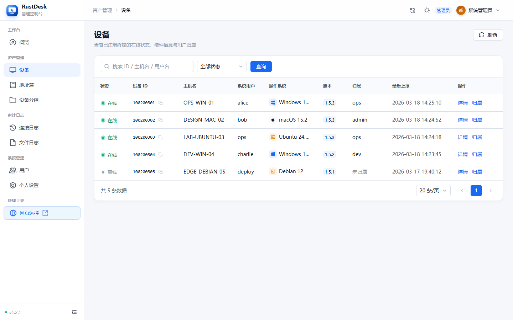

# rustdesk-api-server

<p align="center">
  <i>为自建 RustDesk（hbbs/hbbr）提供 API 服务：账号、地址簿、设备、审计与管理控制台</i>
</p>

<p align="center">
  
  
  
  
  
</p>

一个用 Python / Django 实现的 RustDesk API 服务端，对齐 RustDesk 1.5.x 客户端的 37 个 API 契约，
并提供一套基于腾讯 TDesign（Vue 3 + Vite）的管理控制台，支持多用户数据隔离。

- 客户端侧：登录、地址簿（新旧两代协议）、设备列表、心跳与系统信息、连接/文件审计、设备部署。
- 管理侧：设备与归属、地址簿与标签、设备分组、用户与注册开关、连接/文件日志。
- 部署侧：SQLite 开箱即用，可切 PostgreSQL / MySQL；Docker 镜像与生产部署文档齐备。

## 截图

| 概览 | 设备 |
| --- | --- |
|  |  |

| 地址簿 | 用户 |
| --- | --- |
|  |  |

## 功能特性

- **完整的客户端 API**：37 个「方法 + 路径」组合，含 `login-options`、两代地址簿、`sysinfo`/`sysinfo_ver`/`heartbeat`、
  `audit/conn|file|alarm`、`switch-grant`、`record`、`devices/cli`、`devices/deploy`。契约见
  [docs/client_api_contract.md](docs/client_api_contract.md)。
- **新版多地址簿**：个人簿 + 共享簿，规则分「私有 / 只读 / 读写 / 完全控制」，与客户端同一份数据。
- **彩色标签**：使用 ARGB 颜色值，与客户端标签颜色完全一致。
- **多用户隔离**：管理员看全量；普通用户只看到自己名下设备、个人地址簿和有权限的共享地址簿。
- **首次初始化**：空库访问 `/console/` 时引导创建第一个管理员，之后可关闭自助注册。
- **审计日志**：连接日志（含备注）、文件日志（文件名 / 大小 / 方向）。
- **可运维**：`/api/health` 健康检查、`manage.py doctor` 发布自检、日志轮转、登录节流。

## 快速开始（本地）

```bash
# 1. 安装依赖（Python 3.12）
pip install -r requirements.txt

# 2. 初始化数据库
python manage.py migrate

# 3. 启动（默认 21114 端口）
python manage.py runserver 0.0.0.0:21114
```

打开 `http://127.0.0.1:21114/console/`，首次访问会进入「初始化控制台」页，创建的第一个账号即超级管理员。
客户端「网络 → API 服务器」填写 `http://<服务器IP>:21114`（ID/中继服务器仍指向 hbbs/hbbr）。

不需要控制台时，`/api/*` 可独立工作；控制台只是同一份数据的另一个入口。

## Docker 部署

镜像由 GitHub Actions 自动构建，同时推送到 GHCR 与 Docker Hub（`linux/amd64` + `linux/arm64`）：
推送 `main` 更新 `latest`，打 `v*` 标签生成语义化版本。

- GHCR：`ghcr.io/yunxilyf/rustdesk-api:latest`
- Docker Hub：`yunxi666/rustdesk-api:latest`

### 方式一：docker compose（推荐，免构建）

**1. 准备编排文件**

```bash
mkdir rustdesk-api && cd rustdesk-api
curl -fsSLO https://raw.githubusercontent.com/yunxilyf/rustdesk-api/main/deploy/docker-compose.quickstart.yml
mv docker-compose.quickstart.yml docker-compose.yml
```

**2. 创建 `.env`**

```bash
cat > .env <<'EOF'
DEBUG=0
SECRET_KEY=请替换为随机字符串
ALLOWED_HOSTS=*
CSRF_TRUSTED_ORIGINS=http://127.0.0.1:21114
HTTPS=0
BEHIND_PROXY=0
ALLOW_REGISTRATION=0
EOF
```

生成随机 `SECRET_KEY`：

```bash
python -c "import secrets; print(secrets.token_urlsafe(50))"
```

> 把 `CSRF_TRUSTED_ORIGINS` 改成实际访问地址（IP 或域名，带协议和端口），否则控制台的写操作会被 403。
> 正式对外用 HTTPS 时，再按 `.env.example` 打开 `HTTPS=1`、`BEHIND_PROXY=1` 并填写域名。

**3. 启动并验证**

```bash
docker compose up -d
docker compose ps
curl http://127.0.0.1:21114/api/health
```

浏览器打开 `http://<服务器IP>:21114/console/`，首次访问会引导创建管理员账号。
若需要开放自助注册，把 `.env` 里的 `ALLOW_REGISTRATION` 改为 `1` 后重启容器。

常用命令：

```bash
docker compose pull && docker compose up -d   # 升级到最新镜像
docker compose logs -f --tail=100             # 查看日志
docker compose down                           # 停止（数据保留在 ./data）
```

数据目录：`./data/db`（SQLite 数据库）、`./data/records`、`./data/logs`。
备份时复制 `./data/db/db.sqlite3` 即可。

### 方式二：从源码构建

```bash
git clone https://github.com/yunxilyf/rustdesk-api.git
cd rustdesk-api
cp .env.example .env                             # 修改 SECRET_KEY、ALLOWED_HOSTS
docker compose -f deploy/docker-compose.prod.yaml up -d          # 使用已发布镜像
# 或本地构建：
docker compose -f deploy/docker-compose.prod.yaml up -d --build
```

直接使用 `docker build` 时必须显式指定 `-f deploy/Dockerfile`。

生产环境的 nginx、HTTPS、systemd / gunicorn、备份与升级步骤，见
[docs/deployment.md](docs/deployment.md)。

## 环境变量

完整列表与说明见 [docs/deployment.md](docs/deployment.md)，最常用的几项：

| 变量 | 默认 | 说明 |
| --- | --- | --- |
| `DEBUG` | `0` | 生产必须为 0 |
| `SECRET_KEY` | 内置开发值 | 生产必填，随机长字符串 |
| `ALLOWED_HOSTS` | `*` | 逗号分隔，生产请填实际域名/IP |
| `CSRF_TRUSTED_ORIGINS` | 本机地址 | 带协议与端口，HTTPS 站点填 `https://...` |
| `HTTPS` / `BEHIND_PROXY` | `0` | 开启 Secure Cookie / HSTS / 信任反代头 |
| `CACHE_URL` | 空 | Redis 地址；多进程部署必配，否则登录节流失效 |
| `DATABASE_TYPE` | `SQLITE` | `SQLITE` / `POSTGRES` / `MYSQL` |
| `DEVICE_ONLINE_SECONDS` | `300` | 在线判定窗口，需大于心跳写库间隔 |
| `ALLOW_REGISTRATION` | `True` | 是否允许自助注册（控制台内也可随时开关） |

## 测试与验收

```bash
python manage.py test api.tests -v 1   # 110 项单元 / 集成测试
node e2e/console_e2e.js               # 浏览器 E2E（可选，需 Chrome/Chromium）
```

| 层 | 入口 | 用例数 | 覆盖 |
| --- | --- | --- | --- |
| L1 单元/集成 | `manage.py test api.tests` | 110 | 客户端契约、控制台 API、权限隔离、安全边界、CSRF、心跳写放大 |
| L2 浏览器 E2E | `e2e/console_e2e.js` | 24 | 初始化/登录 → 菜单导航 → 退出，零 JS 错误 |

CI 执行 `ruff check`、`manage.py check`、`migrate`、`ensure_admin`、`doctor`、`api.tests`，并对 `/api/health` 做冒烟。

## 目录结构

```text
api/                     Django 应用：模型、视图、路由、测试
  views_api.py           客户端核心接口（登录、地址簿、sysinfo、审计…）
  views_pro.py           新版客户端接口（多地址簿、设备、分组、部署…）
  console_api.py         控制台 JSON API（Session + CSRF）
  models_pro.py          多地址簿 / 分组 / 切换授权 / 系统设置模型
rustdesk_server_api/     项目配置（settings / urls / wsgi）
frontend/                TDesign 控制台源码（Vue 3 + Vite）
static/console/          控制台构建产物（随仓库提供）
deploy/                  Dockerfile、compose、entrypoint、部署说明
docs/                    API 契约、控制台 API、部署与测试文档
e2e/                     Playwright 端到端脚本
```

## 兼容性与已知限制

- 客户端基线：RustDesk 1.5.x（37 个接口组合），旧版 1.4.x / Sciter 客户端仍可使用 `/api/ab` 旧地址簿。
- 未实现（客户端会静默降级）：心跳响应中的策略下发（`strategy`）、真实 OIDC 登录、共享地址簿的创建授权管理。
- `/api/record` 已按协议实现，但 1.5.x 客户端不会上传录像（其 `record_upload` 开关未开启），录像只保存在被控端本地。
- 收藏（fav）是客户端本地数据，不上报服务端。

## 前端开发

```bash
cd frontend
npm install
npm run dev      # 代理 /api 到 127.0.0.1:21114
npm run build    # 产物输出到 dist/
rm -rf ../static/console && cp -r dist ../static/console
```

## 文档

- [客户端 API 契约](docs/client_api_contract.md)
- [控制台 API](docs/console_api.md)
- [部署指南](docs/deployment.md)
- [测试矩阵](docs/testing.md)

## 致谢

- 感谢 [RustDesk](https://github.com/rustdesk/rustdesk) 开源客户端与服务端；本项目的接口契约来自对其客户端源码的行为分析。
- 感谢 RustDesk 社区。

本项目为独立实现：接口服务、管理控制台与部署脚本均按 RustDesk 1.5.x 客户端行为重新编写，不包含第三方 API 服务端代码。

## 许可证

本项目采用 [MIT License](LICENSE) 开源。
