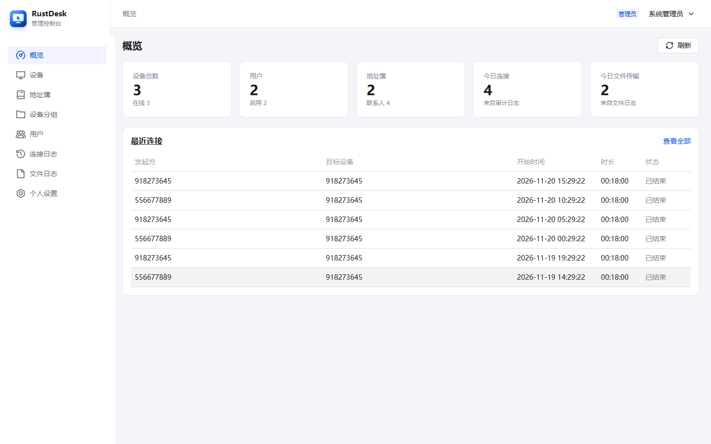
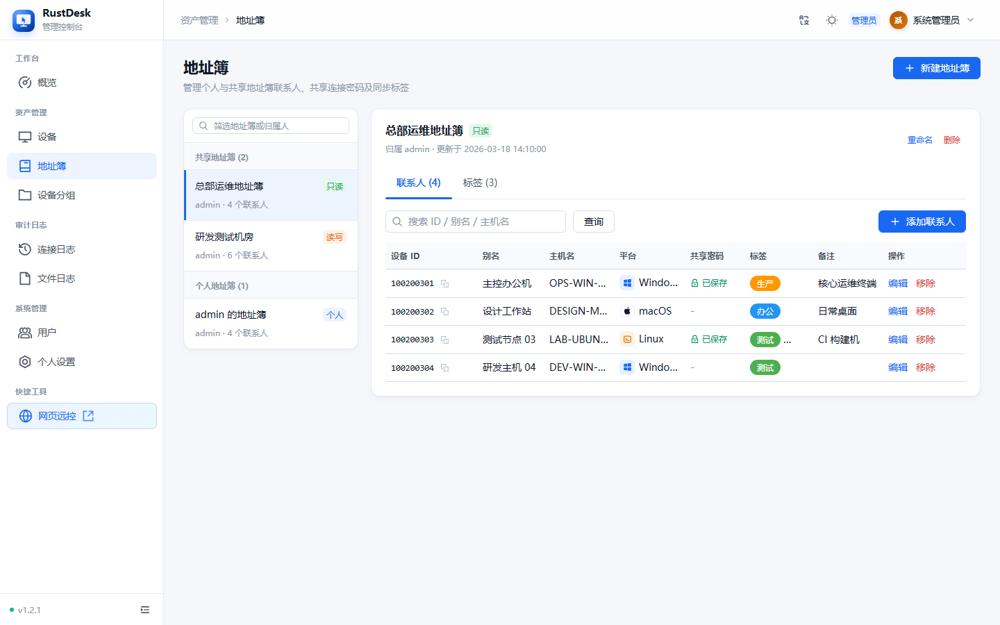
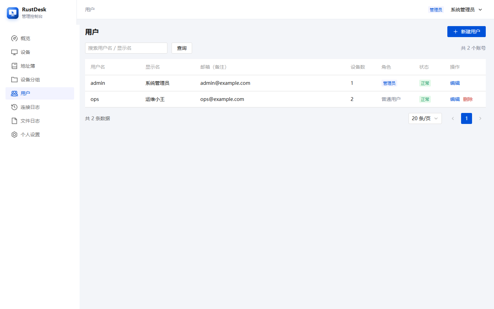
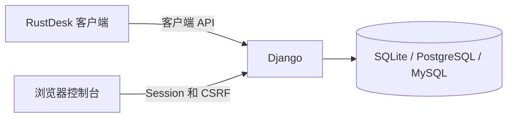

# RustDesk API Server

[English](README_EN.md) · [部署指南](docs/deployment.md) · [客户端 API](docs/client_api_contract.md) · [控制台 API](docs/console_api.md) · [OIDC 登录](docs/oidc.md)

为自建 RustDesk 提供账号、地址簿、设备与审计服务。API 由 Django 提供，管理控制台使用 Vue 3 和 TDesign。侧栏显示当前版本，设置页可一键检查 GitHub 上的新版本。

[](https://github.com/yunxilyf/rustdesk-api/actions/workflows/ci.yml)


[](LICENSE)

## 控制台

| 概览 | 设备 |
| --- | --- |
|  |  |
| **地址簿** | **用户** |
|  |  |

- **客户端**支持登录、个人与共享地址簿、设备上报、连接及文件审计，并兼容旧版单地址簿。
- **管理员**可以管理账号、分配设备归属、设置共享地址簿、分组和注册权限。
- **第三方登录（可选，可并存多个）**：标准 OIDC（Keycloak、Authentik、Entra 等）、Google、GitHub，客户端与控制台登录页都会并列显示按钮；关闭「允许注册」后第三方授权只能登录已有账号。配置见 [docs/oidc.md](docs/oidc.md)。
- **存储**默认使用 SQLite。也支持 PostgreSQL 和 MySQL，多个工作进程可用 Redis 共享登录限流状态。



API 服务独立于 RustDesk 的 ID 和中继服务器。客户端的 ID、Relay 配置继续指向 hbbs、hbbr。

## 本地运行

需要 Python 3.12+ 和 Node.js 22。先安装后端依赖并准备本地配置。

```bash
python -m pip install -r requirements.txt
cp .env.example .env
python -c "import secrets; print('SECRET_KEY=' + secrets.token_urlsafe(50))"
```

将生成的 `SECRET_KEY` 写入 `.env`。PowerShell 中可用 `Copy-Item .env.example .env` 复制配置。初始化管理员时：交互运行会提示输入密码；Docker/CI 等非交互场景会生成随机密码并打印一次。

```bash
python manage.py migrate
python manage.py ensure_admin
npm --prefix frontend ci
npm --prefix frontend run build
python manage.py runserver 127.0.0.1:21114
```

打开 [控制台](http://127.0.0.1:21114/console/) 并使用刚创建的账号登录。本地开发可在另一终端运行 `npm --prefix frontend run dev`，通过 Vite 代理访问 API。

## 免安装运行包

不想装 Docker / Python 时，可直接下载 GitHub Releases 里的独立运行包：

- `rustdesk-api-server-<版本>-linux-x86_64.tar.gz`：解压后 `./rustdesk-api-server`
- `rustdesk-api-server-<版本>-windows-x64.zip`：解压后双击 `rustdesk-api-server.exe`

首次启动会在可执行文件旁创建 `data/` 并自动生成密钥，默认监听 `21114`；详见[独立运行说明](deploy/README-STANDALONE.md)。打 tag（`v*`）时 GitHub Actions 会自动构建并附到 Release。

## 容器部署

GitHub Actions 构建 Linux amd64 和 arm64 镜像。预构建镜像已包含控制台。

| 镜像仓库 | 地址 |
| --- | --- |
| GHCR | `ghcr.io/yunxilyf/rustdesk-api:latest` |
| Docker Hub | `yunxi666/rustdesk-api:latest` |

下载 [Compose 模板](deploy/docker-compose.quickstart.yml) 和 [.env 示例](.env.example)，分别保存为 `docker-compose.yml` 和 `.env`。填好随机 `SECRET_KEY` 后执行以下命令。

```bash
mkdir -p data/db data/records data/logs
docker compose up -d
docker compose exec rustdesk-api python manage.py ensure_admin
curl -fsS http://127.0.0.1:21114/api/health
```

快速开始模板把 21114 发布到所有网卡（`0.0.0.0`），便于内网试用；请用防火墙限制来源，或按部署指南前置 HTTPS 反向代理后再开放公网。生产模板 `deploy/docker-compose.prod.yaml` 默认只绑定 `127.0.0.1`。配置反向代理时设置 `ALLOWED_HOSTS`、`CSRF_TRUSTED_ORIGINS`、`HTTPS=1` 和 `BEHIND_PROXY=1`，并把客户端的 API 服务器指向该 HTTPS 地址。

从源码构建时，在仓库根目录准备 `.env`，然后运行 `docker compose -f deploy/docker-compose.prod.yaml up -d --build`。构建镜像会从 `frontend/` 生成控制台资源。详细配置见 [生产部署指南](docs/deployment.md)。

## 从旧版升级

- 生产启动需要部署方配置的随机 `SECRET_KEY`。使用过旧版默认管理员密码的实例，应轮换该密码。
- 旧版 32 位客户端令牌不再兼容：升级后所有客户端需要重新登录一次，登录后签发新的随机令牌（43 位，30 天滑动续期）。
- 管理员初次初始化使用 `ensure_admin`。需要从网页初始化时，先配置独立的 `WEB_SETUP_TOKEN`，完成后清除。
- 历史录像上传已停用。切换授权在实现设备签名验证前返回拒绝。已有录像文件可继续作为历史数据归档。

## 开发与验证

```bash
ruff check .
ruff format --check .
python manage.py check
python manage.py doctor
npm --prefix frontend run build
```

| 目录 | 内容 |
| --- | --- |
| `api/` | 客户端与控制台视图、设备权限、数据模型 |
| `rustdesk_server_api/` | Django 项目配置和启动入口 |
| `frontend/` | 控制台源码、图标和依赖锁文件 |
| `deploy/` | 容器、反向代理和服务配置 |
| `docs/` | API 契约与部署说明 |

控制台构建输出写入本地 `static/console/`，可由相同的前端源码和锁文件重新生成。测试代码由维护者本地保留，不随仓库分发。

## 致谢与许可

感谢 [RustDesk](https://github.com/rustdesk/rustdesk) 及社区。本项目依据 RustDesk 1.5.x 客户端行为独立实现 API 和控制台，采用 [MIT License](LICENSE)。
