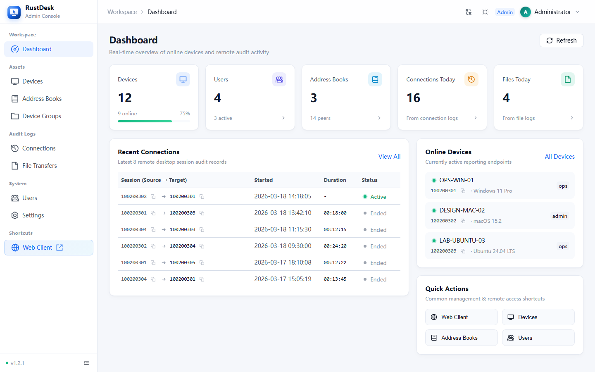
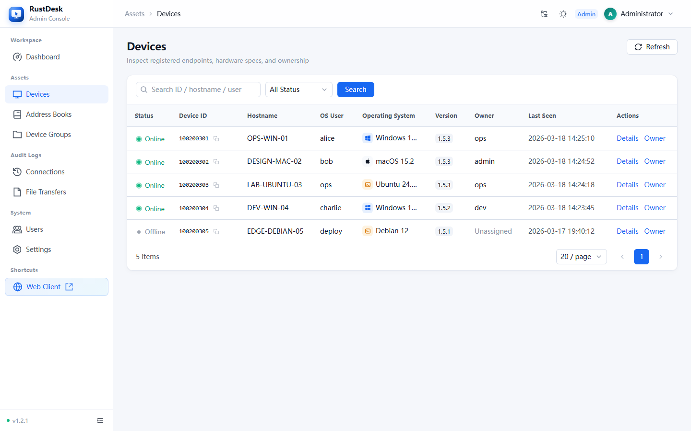
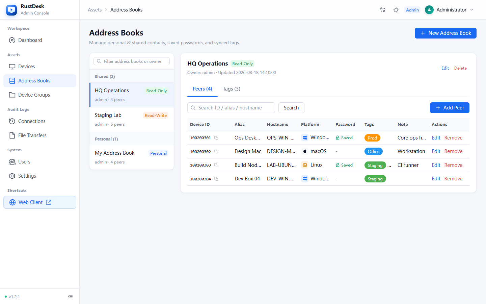
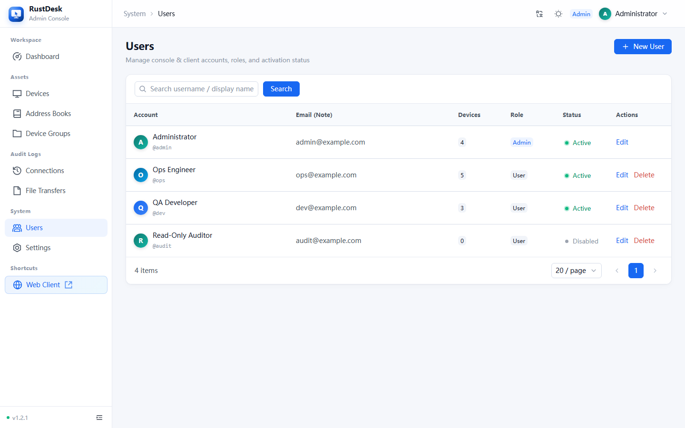

# RustDesk API Server

Optional third-party sign-in with multiple providers side by side — generic OIDC (Keycloak, Authentik, Entra), Google, and GitHub — available from both the client and the console login page. With self-registration disabled, third-party sign-in can only reach existing accounts; see [docs/oidc.md](docs/oidc.md).

[简体中文](README.md) · [Deployment guide](docs/deployment.md) · [Web client](docs/webclient.md) · [Client API](docs/client_api_contract.md) · [Console API](docs/console_api.md) · [OIDC sign-in](docs/oidc.md)

A Django API server, Vue/TDesign console (with light/dark/system themes and Chinese/English switching), and built-in Web client for self-hosted RustDesk. It adds accounts, address books, device ownership, browser remote desktop (shared session login, instant disconnect on logout, personal address book saved-password autofill), and connection/file audit logs to an existing hbbs/hbbr deployment.

[](https://github.com/yunxilyf/rustdesk-api/actions/workflows/ci.yml)

[](LICENSE)

## Console

| Dashboard | Devices |
| --- | --- |
|  |  |
| **Address Books** | **Users** |
|  |  |

## Run locally

Use Python 3.12+ and Node.js 22.

```bash
python -m pip install -r requirements.txt
cp .env.example .env
python -c "import secrets; print('SECRET_KEY=' + secrets.token_urlsafe(50))"
```

Save the generated setting in `.env`. On PowerShell, use `Copy-Item .env.example .env` to copy the sample. The administrator command prompts for a password.

```bash
python manage.py migrate
python manage.py ensure_admin
npm --prefix frontend ci
npm --prefix frontend run build
python manage.py runserver 127.0.0.1:21114
```

Open the [console](http://127.0.0.1:21114/console/) and sign in with the new account. The RustDesk client uses this service as its API server. Its ID and relay settings still point to hbbs/hbbr.

## Standalone binaries

If you prefer not to install Docker or Python, download the self-contained packages from GitHub Releases:

- `rustdesk-api-server-<version>-linux-x86_64.tar.gz`: extract and run `./rustdesk-api-server`
- `rustdesk-api-server-<version>-windows-x64.zip`: extract and launch `rustdesk-api-server.exe`

On first start, the binary creates `data/` alongside the executable, unpacks the bundled Web client into `data/webroot/web`, generates a random secret key, and listens on port `21114`. See [deploy/README-STANDALONE.md](deploy/README-STANDALONE.md) for details.

## Deploy with Compose

The published Linux amd64 and arm64 images bundle the console, built-in nginx, and prebuilt Web client on a single port (`21114`).

| Registry | Image |
| --- | --- |
| GHCR | `ghcr.io/yunxilyf/rustdesk-api:latest` |
| Docker Hub | `yunxi666/rustdesk-api:latest` |

Save the [Compose template](deploy/docker-compose.quickstart.yml) as `docker-compose.yml` and the [environment sample](.env.example) as `.env`. Set a random `SECRET_KEY`, then run the following commands.

```bash
mkdir -p data/db data/records data/logs webroot
docker compose up -d
docker compose exec rustdesk-api python manage.py ensure_admin
curl -fsS http://127.0.0.1:21114/api/health
# Console:    http://127.0.0.1:21114/console/
# Web client: http://127.0.0.1:21114/web/ (shares console login automatically)
```

The quickstart template publishes port 21114 on all interfaces for LAN trials; restrict it with a firewall or put it behind an HTTPS reverse proxy. `deploy/docker-compose.prod.yaml` binds to `127.0.0.1` only. For remote clients, set up an HTTPS reverse proxy and configure `ALLOWED_HOSTS`, `CSRF_TRUSTED_ORIGINS`, `HTTPS=1`, and `BEHIND_PROXY=1`.

To build from source, configure `.env` in the checkout and run `docker compose -f deploy/docker-compose.prod.yaml up -d --build`. See the [deployment guide](docs/deployment.md) for database configuration, reverse proxy and backups.

## Upgrade notes

- Production needs a private random `SECRET_KEY`. Rotate any administrator password set using the old default.
- Clients using old-format tokens need to sign in again. Requests carrying a valid Bearer token can renew it before expiry.
- Use `ensure_admin` for initial setup. Web setup requires a separate `WEB_SETUP_TOKEN` while the database is empty.
- Legacy server recording uploads are disabled. Switch-grant requests return a denial until signature verification is implemented.

## Development

```bash
ruff check .
ruff format --check .
npm --prefix frontend run build
```

Frontend source and lockfiles are in `frontend/`. Vite writes the generated console to `static/console/`.

## Credits and license

This independent implementation follows the RustDesk 1.5.x client contracts. Thanks to [RustDesk](https://github.com/rustdesk/rustdesk) and its community. Released under the [MIT License](LICENSE). The built-in Web client is distributed as a prebuilt package (`deploy/web/rustdesk-web-1.5.3.tar.gz`) derived from temandroid/rustdesk-web (**AGPL-3.0**, source not bundled in this repository); see [docs/webclient.md](docs/webclient.md).
